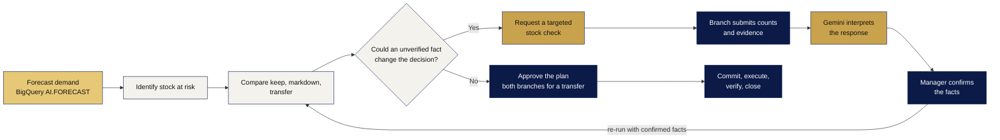

# ShelfShift

**Help retailers act before fresh stock expires.** ShelfShift helps retailers choose whether to keep, discount or
transfer surplus stock to another branch, reducing waste and improving availability where customers need it.

**Check the facts before you act:** where can this stock still sell profitably, and can we make it happen before it
expires?

AI Builder Cup 2026 · Retail & Commerce · Team Sustainity: Krittiya Tagong, Sasaros Kumjim

**[Open the live app](https://shelfshift-5zoznphgnq-as.a.run.app)** · **[Reviewer guide](docs/reviewer-guide.md)** ·
**[Technical notes](docs/technical.md)**

## The problem

Surplus fresh stock at some branches and shortages at others cause avoidable food waste, tie up working capital and
lead to lost sales when managers cannot act before expiry. Managers have little time to decide, and the stock record
they decide on is often wrong: units on paper aren't on the shelf, or the printed dates differ from the system.

## What ShelfShift does

One stock pool across branches, sold before it expires. For each at-risk lot, ShelfShift answers: **move it, how many
units, to which branch and by when? Is that better than marking it down or keeping it? And are the stock facts behind
the answer real?**

- **Less unnecessary checking:** staff check only the facts that could change the decision.
- **Fewer uneconomic rescues:** value recovered is weighed against markdown, transport and handling costs.
- **Fewer mismatched actions:** both branches carry out the same current, approved plan.

The engine computes, Gemini explains, people decide:

Light: deterministic code · Yellow: predictive AI · Gold: Gemini agent · Dark: people

What is built: a risk inbox and decision board; stock, forecasts and analytics; stock verification and
recalculation; option comparison with binding limits and switch points; transfer planning; tasks and a planned
schedule; approvals with version checks and resource holds; execution, receipts and an audit history. Gemini writes a
decision brief for each plan, answers questions about it, and reads field reports (text, photos and PDFs) into
suggested fields that a manager confirms. Every figure Gemini cites links back to the engine's result.

## For reviewers

Start with the **[reviewer guide](docs/reviewer-guide.md)**: it covers signing in, the test accounts and four
walkthroughs. The passcodes are on slide 12 of the submitted deck ("Provide links to your"). Every reviewer gets a
private workspace in their own browser, so nothing you do affects anyone else.

| Try | Sign in as | Where |
|---|---|---|
| Gemini explains a decision and answers questions | Store `S189` | Product P129 → **4. Compare** → Decision brief and **Ask about this stock decision** |
| Verify before you move | Store `S329` | Product P191 → **2. Context** → **Count stock**, answer it in **Tasks**, see the plan change |
| A transfer across two stores | `S538`, then `S892` | Product P267: send, accept, approve, dispatch, receive, close |
| Gemini reads a field report | Store `S223` | **Business events** → **Report an observation** → describe a broken chiller |

Sample photos and PDFs to submit are in [docs/guide](docs/guide/README.md).

## Tech stack

A hybrid decision system with one job per component, in one Cloud Run service.

| Component | Technology | Its job |
|---|---|---|
| Gemini agent | Gemini 3.5 Flash on Vertex AI, Google ADK tools | Reads branch messages, photos and documents; explains plans; answers questions |
| Forecasting | BigQuery `AI.FORECAST` (TimesFM, ARIMA_PLUS fallback), precomputed in batch | Expected demand and its uncertainty by branch and product |
| Decision engine | Pure Python, deterministic | Simulates keep, markdown and transfer under low, base and high demand; explains why an option wins |
| People | Store managers and HQ planners | Confirm facts and approve every action, as separate steps |
| Interface | React, TypeScript, Vite, Tailwind CSS, Chart.js | Today, decision board, case steps, approvals, execution |
| API and data | Python 3.12, FastAPI, Pydantic, SQLAlchemy with pg8000 | Sessions, roles, validation, version checks |
| Google Cloud | Cloud Run, Cloud SQL (PostgreSQL 17), Cloud Storage, Secret Manager and IAM, Cloud Build, Artifact Registry, Cloud Logging | Hosting, data, uploads, passcodes, releases |
| Testing | pytest, Playwright | Engine, API and browser suites; each release benchmarks, smoke-tests and walks the reviewer's path before switching traffic |

Why the results can be trusted: versioned inputs and reproducible results; idempotency keys stop repeated changes;
transactions, locks and version checks block stale approvals; every financial and stock figure comes from the engine;
confirming evidence and approving are separate human actions.

To run it locally (Docker, no Google account needed), see the [technical notes](docs/technical.md).

## Submission state

| | |
|---|---|
| **Live** | Everything under "What is built" above, on Cloud Run, with live Gemini |
| **Real** | Sales history from FreshRetailNet-50K (public, CC BY 4.0); demand forecasts from BigQuery; Gemini answers and readings |
| **Simulated** | Stock, lots, expiry dates and deliveries. Prices, costs and shelf life are labelled assumptions. Every screen says "Public sales dataset · Simulated operational scenario" |
| **Not finished** | Branch replenishment orders (built with OR-Tools CP-SAT, not in this release); the fair-comparison benchmark (built, not yet run, so Reports shows no comparison numbers); the scored AI evaluation (built, not yet run); the monthly cost estimate (set after measured traffic) |
| **Prototype limits** | Shared passcodes per role instead of personal sign-in; one small server and database; a daily AI limit shared by all reviewers; no point-of-sale or supplier feed; no store trial yet |

More limits and what is not yet proven are in the [technical notes](docs/technical.md#limitations).

## Future

From a public-data prototype to a verified retail pilot:

1. **Now · current integration:** complete the public-data product and verify Gemini tool use in the deployed build.
2. **Next · evaluation and scale:** publish the fair comparison, including ties and losses. Load test before
   extending to more branches.
3. **Pilot · retail pilot:** connect retailer stock feeds and validate markdown, case-size and display assumptions
   with store teams.
4. **Full version · sustainability:** carbon footprint calculation covering transport and waste. Carbon accounting is
   future work: any reduction claim requires verified activity data and a defined comparison, and transport emissions
   can offset waste savings.

## Data

Sales history: [FreshRetailNet-50K](https://huggingface.co/datasets/Dingdong-Inc/FreshRetailNet-50K) by
Dingdong-Inc, CC BY 4.0. ShelfShift is not affiliated with or endorsed by Dingdong-Inc. The scenario is hypothetical.
See [DATASET.md](DATASET.md) for the attribution, assumptions and modifications. Exploratory analysis of the dataset:
[Demand Forecasting and Inventory Safety notebook](https://github.com/khadija2027/Demand-Forecasting-and-Inventory-Safety-in-the-Retail-Sector).
